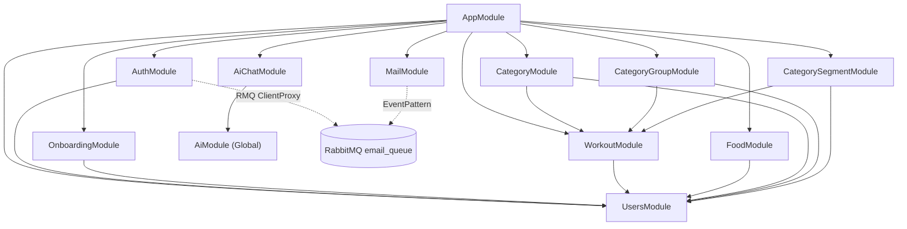
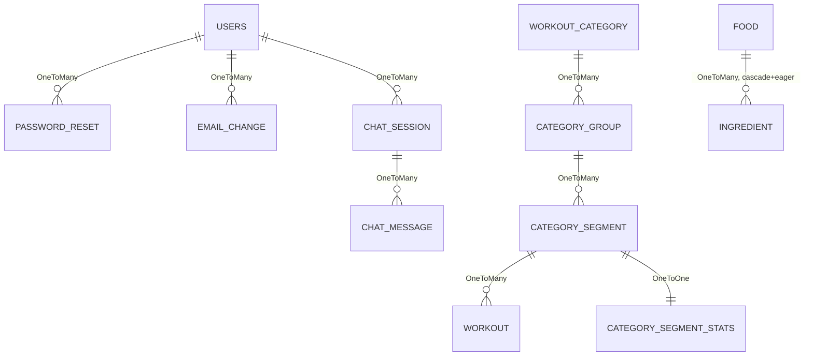
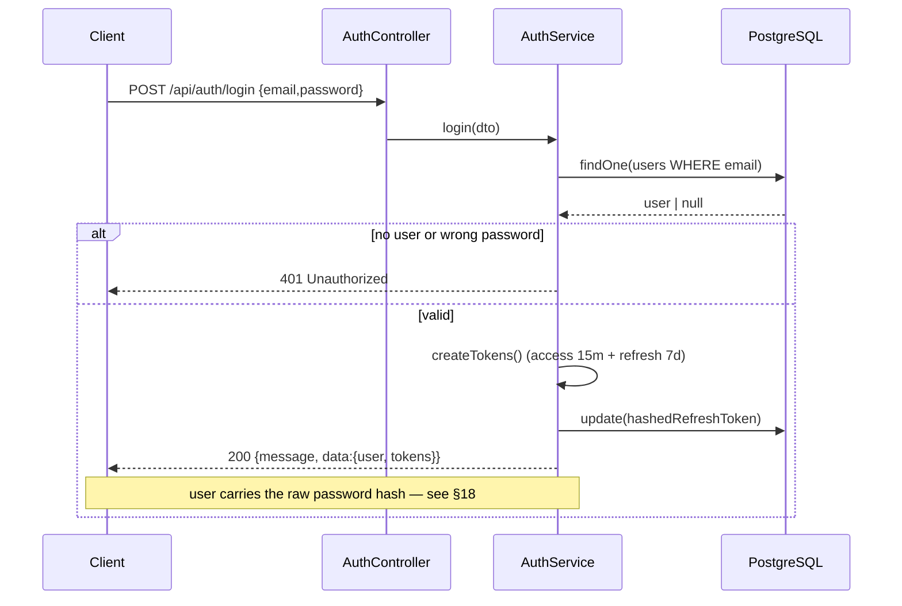
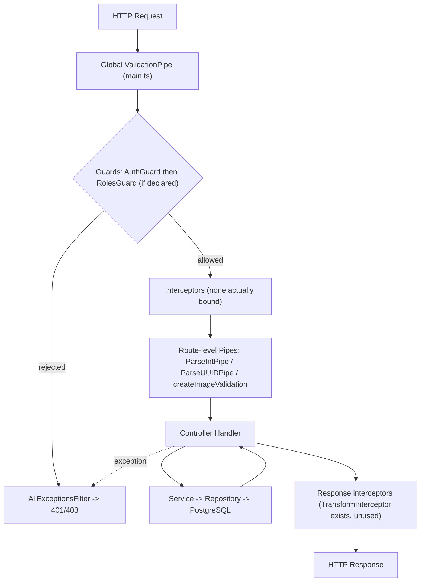
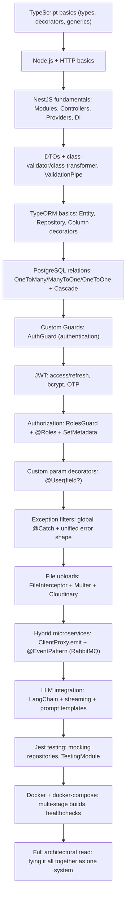

# Super Fitness API — Project Analysis

> Reverse-engineering document, Phase 1. Every fact here was verified by reading the actual source in `src/` and the root config files — not inferred from naming or convention alone. Where something could not be confirmed, it is explicitly marked **UNCONFIRMED**. This file is the map; `docs/NESTJS_LEARNING_BOOK.md` is the curriculum built from it. When code and this document disagree, the code wins — update this file.

---

## Table of Contents

1. [Executive Summary](#1-executive-summary)
2. [Project Purpose](#2-project-purpose)
3. [Tech Stack](#3-tech-stack)
4. [Project Structure](#4-project-structure)
5. [Architecture](#5-architecture)
6. [Module Map](#6-module-map)
7. [NestJS Features In Use](#7-nestjs-features-in-use)
8. [Database](#8-database)
9. [Authentication](#9-authentication)
10. [Authorization](#10-authorization)
11. [API Map](#11-api-map)
12. [Request Lifecycle](#12-request-lifecycle)
13. [Business Logic](#13-business-logic)
14. [External Integrations](#14-external-integrations)
15. [Validation](#15-validation)
16. [Error Handling](#16-error-handling)
17. [Configuration](#17-configuration)
18. [Security Review](#18-security-review)
19. [Testing](#19-testing)
20. [DevOps](#20-devops)
21. [Dependency Analysis](#21-dependency-analysis)
22. [Code Quality](#22-code-quality)
23. [Important Technical Decisions](#23-important-technical-decisions)
24. [Project Mental Model](#24-project-mental-model)
25. [Learning Dependency Map](#25-learning-dependency-map)
26. [Unknowns](#26-unknowns)
27. [Recommended Learning Order](#27-recommended-learning-order)

---

## 1. Executive Summary

**Super Fitness API** is a single NestJS 11 backend (a modular monolith) for a fitness app: auth, onboarding, profile management, a hierarchical workout catalog with video, a food/nutrition catalog, and an AI coaching chat (Gemini via LangChain) with persisted history. Database is PostgreSQL via TypeORM. Email is sent asynchronously through RabbitMQ — the project's one and only use of `@nestjs/microservices`. Auth is JWT (access + refresh) with bcrypt password hashing. Swagger docs live at `/api-docs`.

**The single most important finding**, verified directly in code (details in [§18](#18-security-review)):

> **CRITICAL** — The bcrypt password hash and the hashed refresh token are leaked in API responses. `@Exclude()` on `UserEntity.password` only works if `ClassSerializerInterceptor` is bound — a project-wide search confirms it never is. So `POST /api/auth/login`, `GET /api/users/profile`, the profile-update endpoints, and especially `GET /api/users` (admin — returns *every* user) all return the raw entity, hash included.

Other headline findings:
- Rate limiting is registered globally (`ThrottlerModule.forRoot`) but `ThrottlerGuard` is only ever bound manually on `POST /api/ai-chat` — login, register, and OTP endpoints have no brute-force protection despite the README's claim.
- `TransformInterceptor` (a `{success,message,data}` response envelope) is fully written but never registered anywhere — confirmed dead code, with a concrete symptom: the standalone dev script `src/common/utils/ai-client.js` expects a triple-nested response shape that only makes sense if this interceptor were active.
- Workout video upload has no size/type validation, unlike onboarding image upload.
- No `test/` directory exists despite a `test:e2e` npm script referencing one — that script currently fails immediately.

---

## 2. Project Purpose

A backend for a fitness mobile/web app with two roles, `UserType.USER` and `UserType.ADMIN`. It solves:

- **Identity**: registration, email verification, login, password reset, email change — all backed by JWT sessions.
- **Progressive onboarding**: a 3-step wizard (personal info → body info → fitness goals) tracked via `UserEntity.currentStep` / `isOnboardingCompleted`.
- **Hierarchical workout catalog**: Category → Group → Segment → Workout (with a demo video on Cloudinary), filterable by difficulty/duration/calories.
- **Nutrition catalog**: foods with nested ingredients and macros (calories/protein/carbs/fats), tagged by meal (breakfast/lunch/dinner).
- **AI coach**: a chat interface backed by Gemini (via LangChain), personalized with the user's profile (name/age/goal/activity level), with persisted sessions and messages.

The welcome email template refers to the brand "FTNS" — likely an internal project name, not otherwise referenced anywhere in code or docs.

---

## 3. Tech Stack

| Layer | Technology | Where it's actually used |
|---|---|---|
| Framework | `@nestjs/core` ^11, `@nestjs/platform-express` | Everywhere |
| Language | TypeScript 5.7 — `strictNullChecks:false`, `noImplicitAny:false` | Everywhere (note: strictness partially disabled) |
| Database | PostgreSQL + `typeorm` 0.3 + `@nestjs/typeorm` + `pg` | `app.module.ts` connection, every `*.entity.ts` |
| Auth | `@nestjs/jwt`, `bcrypt` | `AuthService`, `AuthGuard` |
| Validation | `class-validator`, `class-transformer` | Every DTO + the global `ValidationPipe` |
| API docs | `@nestjs/swagger` | `main.ts` → `/api-docs` |
| Rate limiting | `@nestjs/throttler` | Registered globally, but manually applied on one route only ([§18](#18-security-review)) |
| Messaging | `@nestjs/microservices` + `amqplib` + `amqp-connection-manager` (RabbitMQ) | Email sending only — queue `email_queue` |
| Email | `nodemailer` + `handlebars` | `MailService` + `.hbs` templates under `modules/mail/templates` |
| Media storage | `cloudinary` SDK | `CloudinaryService` (onboarding images, workout videos) |
| AI | `@langchain/core`, `@langchain/google-genai`, `@google/generative-ai` | `AiModule` + `AiChatService`, model `gemini-3-flash-preview` |
| Logging | `winston`, `nest-winston`, `winston-daily-rotate-file` | `common/logger.ts`, the app-wide logger passed to `NestFactory.create` |
| HTTP client | `axios` | **Not used inside the Nest app at all** — only in the standalone dev script `src/common/utils/ai-client.js` |
| Build | `@nestjs/cli` (plain `tsc`) — `@swc/core`/`@swc/cli` are installed but not wired into `nest-cli.json` | — |
| Code quality | ESLint 9 flat config (typescript-eslint recommendedTypeChecked), Prettier, Husky + lint-staged | `.husky/pre-commit` → `npx lint-staged` |
| Tests | Jest + ts-jest, `@nestjs/testing`, `supertest` (installed, unused for E2E) | 8 `*.spec.ts` files, no E2E |
| Containers | Multi-stage Docker + Docker Compose (dev/production) | `Dockerfile` (used), `Dockerfile.prod` (unused — [§20](#20-devops)) |

---

## 4. Project Structure

Feature-based, not layer-based. Each module under `src/modules/` typically owns its own `controller`, `service`, `module`, `dto/`, `entity/`.

| Path | Contents |
|---|---|
| `src/main.ts` | Bootstrap: hybrid app (HTTP+RMQ), global pipes/filters, Swagger. |
| `src/app.module.ts` | Root module — wires every feature module, Throttler/Config/TypeORM. |
| `src/common/` | `decorators/` (`@Roles`, `@User`), `interceptors/` (one, unused), `interface/` (`UserReq`), `pipes/` (image validation), `services/` (Cloudinary + guards), `utils/` (constants/enums/types/OTP/AI prompt), `logger.ts`, `all-exceptions.filter.ts`, `health.controller.ts`. |
| `src/modules/auth/` | Login/logout, register, verify email, forgot/reset password, change email. |
| `src/modules/users/` | Profile, the 3 onboarding steps, change password, admin user list. |
| `src/modules/onboarding/` | **Not** the user onboarding wizard — an admin-managed CMS for app intro slides (title+description+image). See the naming collision note in [§13](#13-business-logic). |
| `src/modules/category/`, `category-group/`, `category-segment/` | Three levels of the workout taxonomy. |
| `src/modules/workout/` | Actual workouts (with Cloudinary video), belong to a `CategorySegment`. |
| `src/modules/food/` | Foods and their ingredients. |
| `src/modules/ai-chat/` + `src/modules/ai/` | Chat sessions/messages, and a `@Global()` module providing the Gemini model. |
| `src/modules/mail/` | Sending service (nodemailer/handlebars) + RabbitMQ consumer (`MailProcessor`) + `.hbs` templates. |
| `src/common/utils/ai-client.js` | Standalone interactive CLI script for manually testing login + chat from a terminal — not part of the compiled Nest app. |

**Does not exist**, despite the scaffolding implying it could: a `test/` folder (E2E), a `migrations/` folder, any CI/CD config (no `.github/`).

---

## 5. Architecture

**Modular Monolith** with one hybrid extension: the app is a single Node process (`NestFactory.create`) that also runs a RabbitMQ microservice connection (`app.connectMicroservice`) for exactly one purpose — asynchronous email. This is NestJS's "hybrid application" pattern, not a true microservices deployment.

**Responsibility split**: Controllers define routes/guards/DTO shape only (almost no business logic). Services hold all business logic and query via TypeORM `Repository<T>` directly — there is no abstract repository layer. Entities define the table + relations + (unusually) some Swagger `@ApiProperty` decorators live directly on the entity, mixing data model and API documentation.

**Design patterns observed:**

| Pattern | Where | Assessment |
|---|---|---|
| Dependency Injection | Everywhere | Correct, consistent constructor injection. |
| Module pattern | Every `*.module.ts` | Good, but with repeated unused imports ([§22](#22-code-quality)). |
| Factory provider | `AiModule` (`useFactory` for `ChatGoogleGenerativeAI`), `TypeOrmModule.forRootAsync`, `ClientsModule.registerAsync` | Standard, correct Nest usage. |
| Global module | `AiModule` (`@Global()`) | Reasonable for a single cross-cutting value (`GEMINI_MODEL`). |
| Guard-as-strategy | `AuthGuard` (authn) + `RolesGuard` (authz) | Good separation in principle; inconsistently applied ([§18](#18-security-review)). |
| Response-transform interceptor | `TransformInterceptor` | Written, **never activated** — dead code ([§16](#16-error-handling)). |
| Event-driven (fire-and-forget) | `ClientProxy.emit('email.send', …)` | Decouples slow SMTP from the request cycle; no visible failure feedback ([§14](#14-external-integrations)). |

**Smells**: no abstract repository layer (fine at this scale); repeated injection of `JwtService`/`UsersService`/`UserEntity`/`WorkoutModule` into modules that never use them, suggesting copy-pasted module boilerplate.

---

## 6. Module Map

Edges below are real `imports:` declared inside each `@Module()` — not just a shared provider.

`Category`, `CategoryGroup`, and `CategorySegment` all import `WorkoutModule` even though none of their services inject `WorkoutService` — likely a copy/paste artifact.

---

## 7. NestJS Features In Use

| Feature | Used? | Where / how it connects |
|---|---|---|
| Modules | ✔ | 12 feature modules + root `AppModule`. |
| Controllers / Providers / DI | ✔ | Standard everywhere. |
| Custom (`useFactory`) Providers | ✔ | `AiModule` (`GEMINI_MODEL`), `TypeOrmModule.forRootAsync`, `ClientsModule.registerAsync` (`EMAIL_QUEUE`). |
| Dynamic Modules | ✔ (indirect) | `forRootAsync`/`forFeature`/`registerAsync` from official Nest libs — no custom dynamic module in the project itself. |
| Global Modules | ✔ | `AiModule` only. |
| Guards | ✔ | `AuthGuard` (JWT), `RolesGuard` (role check), `ThrottlerGuard` (one route only). |
| Interceptors | ⚠️ defined, not active | `TransformInterceptor` exists but is never bound anywhere. |
| Pipes | ✔ (mostly built-in) | Global `ValidationPipe`; route-level `ParseIntPipe`/`ParseUUIDPipe`; a custom `ParseFilePipeBuilder` factory (`createImageValidation`) — no custom `PipeTransform` class. |
| Middleware (`NestModule.configure`) | ✘ | None in the project. |
| Exception Filters | ✔ | `AllExceptionsFilter`, registered globally in `main.ts`. |
| Custom Decorators | ✔ | `@Roles(...roles)` (metadata), `@User(field?)` (param decorator reading `request.user`). |
| Lifecycle Hooks | ✔ | `OnModuleInit` in `MailService` to build the nodemailer transporter after `ConfigService` is injected. |
| Request-scoped Providers | ✘ | Everything is default Singleton scope. |
| ConfigModule | ✔ | `ConfigModule.forRoot({isGlobal:true})` — no schema validation on env vars. |
| ValidationPipe | ✔ | Global, `whitelist:true, forbidNonWhitelisted:true, transform:true`. |
| Swagger | ✔ | `DocumentBuilder` + `addBearerAuth()`, served at `/api-docs`. |
| Scheduling (Cron) | ✘ | No `@nestjs/schedule`. |
| Events (`EventEmitter`) | ✘ | No `@nestjs/event-emitter` — async communication is RabbitMQ-only. |
| Microservices (Hybrid) | ✔ | `app.connectMicroservice` (RMQ) + `@EventPattern('email.send')` in `MailProcessor`. |
| WebSockets | ✘ | AI response "streaming" is internal only (`chain.stream()`), fully buffered before being returned as one normal HTTP response — not SSE/WebSocket. |

---

## 8. Database

**PostgreSQL** via **TypeORM 0.3**. `TypeOrmModule.forRootAsync` in `app.module.ts`: `autoLoadEntities:true`, `synchronize` is only `true` when `NODE_ENV==='development'`. There are no migration files anywhere in the project — the project relies entirely on `synchronize` in dev, with no visible migration mechanism for production despite the README calling migrations "required" there.

### Relationship map

`onboarding` (the CMS slides table) is a standalone entity with no relation to anything else — it is intentionally omitted from the diagram above.

### Entities

| Table | Key | Notable columns | Notes |
|---|---|---|---|
| `users` | UUID | `email` (unique), `password` (bcrypt, `@Exclude()` inert), `type` enum, `currentStep`, `isOnboardingCompleted`, `hashedRefreshToken` | Central entity, 3 outgoing relations. |
| `password_reset` | UUID | `otp` (6 digits), `expiresAt`, `isUsed` | `ManyToOne users`, `onDelete:CASCADE`. |
| `email_change` | UUID | `newEmail`, `otp`, `expiresAt`, `isUsed` | Same pattern as `password_reset`. |
| `onboarding` | UUID | `title`, `description`, `secure_url`/`public_id` (Cloudinary), `order_index`, `is_active` | No relations — pure CMS content. |
| `chat_session` | UUID | `title` (first 30 chars of first message) | `ManyToOne users`, `OneToMany chat_message` (both CASCADE). |
| `chat_message` (class `ChatMessage`) | Serial int | `content`, `sender` enum (USER/AI) | `ManyToOne chat_session` CASCADE. |
| `workout_categories` | Serial int | `name` (unique) | Hierarchy level 1. |
| `category_groups` | Serial int | `name` | Level 2 — `@Unique(['category','name'])`. |
| `category_segments` | Serial int | `name` | Level 3 — `@Unique(['group','name'])`. |
| `category_segment_stats` | Serial int | `views` | Side table isolating the view counter from `category_segments`. |
| `workouts` | Serial int | `difficulty` enum (indexed), `videoUrl`/`videoPublicId`, `durationMinutes`, `calories` | `segment` relation is `eager:true`. |
| `foods` | Serial int | `category` enum (MealCategory), float macros | `ingredients` relation is `cascade:true, eager:true`. |
| `ingredients` | Serial int | `quantity`, `unit` | `ManyToOne foods` CASCADE. |

> **Convention split**: UUID primary keys are used for user-facing/sensitive entities (`users`, `password_reset`, `email_change`, `chat_session`, `onboarding`); serial integers are used for admin catalog entities (categories, workouts, foods, messages). This split looks intentional (harder to guess user-linked IDs) but is not commented on anywhere in the code — see [§26](#26-unknowns).

---

## 9. Authentication

JWT-only, two tokens, no sessions/cookies. Token travels as `Authorization: Bearer <token>`.

| Property | Value | Source |
|---|---|---|
| Access token | 900s (15 min), secret `JWT_ACCESS_SECRET` | `AuthService.createTokens()` |
| Refresh token | 604800s (7 days), secret `JWT_REFRESH_SECRET` | Same method |
| Refresh token storage | One bcrypt hash per user in `users.hashedRefreshToken` (no multi-token table) | `updateRefreshToken()` |
| Password hashing | `bcrypt`, 10 rounds, everywhere a password/token is stored | — |
| Email verification | 32-byte random hex token (`crypto.randomBytes(32)`), sent as a link `GET /auth/verify-email?token=` | `register()` |
| Password reset / email change | 6-digit numeric OTP (`crypto.randomInt`), 15 min (password) / 10 min (email) validity | `otp.util.ts` |

### Login flow

`AuthGuard.canActivate()`: reads `Authorization`, requires `Bearer `, verifies with `JWT_ACCESS_SECRET`, then loads the **full user row** from the database via `UsersService.findById` (not just trusting the JWT payload) and sets `request.user`. Any failure collapses to one `UnauthorizedException`.

`POST /api/auth/refresh` verifies the refresh token, compares it against the stored bcrypt hash, and issues a new pair (simple rotation, no reuse-detection "family"). `logout()` only clears `hashedRefreshToken` — the current access token stays valid until its natural 15-minute expiry.

Login does **not** check `isEmailVerified` — unverified accounts can use the API immediately (see [§26](#26-unknowns)). Email-change OTP is sent to the *new* address only, with no notification to the old one.

---

## 10. Authorization

Single role per user (`UserType.USER` / `UserType.ADMIN`) — no fine-grained permissions or policy engine.

`@Roles(...roles)` sets metadata via `SetMetadata`; `RolesGuard.canActivate()` reads it via `Reflector.getAllAndOverride` — if absent, any authenticated user passes; if present, `user.type` must be included or it throws `ForbiddenException`. Guard order is always `@UseGuards(AuthGuard, RolesGuard)` (`AuthGuard` must populate `request.user` first) — correct and consistent **except** in `AiChatController`.

> **HIGH** — `AiChatController` applies only `@UseGuards(AuthGuard)` at the class level (no `RolesGuard`), yet its handlers carry `@Roles(UserType.USER)`. Since role metadata is only read inside `RolesGuard`, this decorator is inert — any authenticated user, including ADMIN, can call the chat endpoints regardless of the apparent intent.

---

## 11. API Map

Global prefix: `/api` (`app.setGlobalPrefix('api')`).

**Auth** — `/api/auth`: `POST /login`, `POST /refresh`, `POST /logout` (auth), `POST /forgot-password`, `POST /register`, `GET /verify-email?token=`, `POST /verify-reset-code`, `POST /reset-password`, `POST /change-email/request` (auth), `POST /change-email/verify` (auth).

**Users** — `/api/users` (AuthGuard+RolesGuard): `GET /profile`, `PATCH /profile`, `PATCH /personal-info`, `PATCH /body-info`, `PATCH /fitness-goals`, `GET /` (ADMIN — leaks hashes, §18), `PATCH /change-password`.

**Onboarding CMS** — `/api/onboarding`: `GET /` (USER,ADMIN), `POST /` (ADMIN, multipart image), `PATCH /:id` (ADMIN), `DELETE /:id` (ADMIN).

**Category tree** — `/api/category`, `/api/category-group`, `/api/segments`: standard CRUD per level, creation/update/delete = ADMIN, plain reads = USER or any authenticated user (routes without `@Roles`), plus `POST /segments/:id/view` (increment) and `GET /segments/:id/stats`.

**Workouts** — `/api/workouts`: `POST /` (ADMIN, multipart video, **no validation** — §18), `GET /` (filtered+paginated), `GET /segment/:segmentId`, `GET /:id`, `PATCH /:id` (ADMIN), `DELETE /:id` (ADMIN, 204), `DELETE /:id/video` (ADMIN).

**Foods** — `/api/foods`: `POST /` (ADMIN), `GET /` (filtered), `GET /:id` (any authenticated), `DELETE /:id` (ADMIN), plus nested ingredient CRUD under `/:foodId/ingredients`.

**AI Chat** — `/api/ai-chat` (AuthGuard only — see §10): `POST /` (+ThrottlerGuard), `GET /history?page=&limit=`, `DELETE /session/:id`.

**Health** — `GET /api/health`: unauthenticated, runs `SELECT 1`; on failure throws a generic `Error` which becomes a 500 via `AllExceptionsFilter` (not the 503 its Swagger doc implies).

---

## 12. Request Lifecycle

No custom middleware exists in this project, so the real pipeline starts at the guards:

Practical consequence: successful-response shape is **not** uniform across modules — Auth mostly returns `{message, data}` manually; Users/Category/Workout/Food return the entity/array directly with no envelope. Only error responses are uniform, via `AllExceptionsFilter`.

---

## 13. Business Logic

**Auth & Users** — full account lifecycle + progressive profile completion. `register()` does not block login before verification. `currentStep` updates on each wizard step but the service does not enforce step order — nothing stops calling `PATCH /fitness-goals` first (any ordering is presumably enforced client-side only, if at all). `forgotPassword` invalidates all previous unused OTPs before issuing a new one.

> **Naming collision**: `OnboardingEntity`/`OnboardingModule` (admin-managed intro slides) has nothing to do with the user's onboarding *wizard* (`currentStep`, inside `UsersModule`). Easy to conflate on first read.

**Workout taxonomy** — 4-level hierarchy, unique names enforced per parent at every level, fully cascading deletes. View counter lives in its own table (`CategorySegmentStats`), most likely to reduce write contention on the frequently-filtered `category_segments` table — **not confirmed** in code. `CategorySegmentService.getPopularSegments()` is fully implemented but not called from any controller — dead-but-ready logic.

**Foods** — fully independent of the workout hierarchy. `CreateFoodDto` accepts nested `ingredients`; `FoodService.create()` relies on the `cascade:true` relation to persist them in one `save()` call.

**AI chat** — personality/context built from the user's profile fields directly. A session is auto-created if no `sessionId` is sent; the title is just the first 30 characters of the first message. Each exchange (user message + model call + AI message) happens inside one DB transaction (`dataSource.transaction`), which guarantees no "orphaned" user message but also means the LLM call sits inside an open transaction for its full duration.

---

## 14. External Integrations

| Service | Usage | Config | On failure |
|---|---|---|---|
| **Cloudinary** | Upload/delete onboarding images and workout videos (base64 data URI from memory, 6MB chunking for video) | `CloudinaryService` constructor reads `CLOUDINARY_*` | Upload failure → `BadRequestException`. Delete failure on update/remove → logged as a warning only, execution continues (can leave orphaned files). |
| **RabbitMQ** | One durable queue, `email_queue`; hybrid microservice inside the same process | `RABBITMQ_URL` — used in both `main.ts` (consumer) and `AuthModule` (`ClientProxy` producer) | `emailClient.emit()` is fire-and-forget — no ack wait, no explicit publish-failure handling on the sender side. |
| **SMTP (nodemailer)** | Actual send, inside `MailProcessor` (the queue consumer) | `SMTP_HOST/PORT/USER/PASS/FROM`; `secure:true` only when port is 465 | Error is logged then re-thrown — relies on RabbitMQ's default requeue/reject behavior; no explicit retry/DLQ config visible. |
| **Google Gemini (LangChain)** | Chat responses, internally streamed then joined into one string | `GOOGLE_API_KEY`, model `gemini-3-flash-preview`, `maxRetries:3`, `temperature:0.7` | Whole DB-transaction+LLM block is wrapped in `try/catch` → `BadRequestException('Failed to get response from AI')`, original error logged. |

---

## 15. Validation

- **App-wide**: global `ValidationPipe` — `whitelist:true` (strips unknown fields), `forbidNonWhitelisted:true` (rejects the whole request instead of silently stripping), `transform:true` (enables `@Type(() => Number)` on query DTOs).
- **DTOs (class-validator)**: used on nearly every write route. The same password-strength regex (`/^(?=.*[a-z])(?=.*[A-Z])(?=.*\d)(?=.*[@$!%*?&])/`) is duplicated literally across 4 files (`login`, `register`, `reset-password`, `change-password`) instead of a shared constant/decorator. `PartialType` is used for update DTOs (Onboarding, Workout, CategorySegment, Ingredient).
- **File validation**: `createImageValidation()` via `ParseFilePipeBuilder` (Onboarding only) — type-restricted (jpeg/png/webp/gif), 5MB max. Workout video upload has no equivalent (§18).
- **Business validation in services**: name uniqueness (category/group/segment), old-password match, new-password-must-differ, new-email-must-differ, segment existence before creating a workout.
- **DB constraints**: composite `@Unique` (category+name, group+name), simple `unique:true` (email, category name), column-level `enum` types.

---

## 16. Error Handling

`AllExceptionsFilter` (`@Catch()` — catches everything), registered globally in `main.ts`, is the one real unified error system.

- `HttpException` → extract status + message (supports `class-validator`'s array-of-messages, joined with `, `).
- Anything else (plain JS `Error`) → status 500, message = `error.message`.
- Response shape is always `{success:false, message, data:null}` + `timestamp` outside production only.
- Stack traces are logged (not returned to the client) only outside production.
- Log level: `error` for 500s, `warn` for ≥400 — never logs successes.

> **MEDIUM** — Successful responses are *not* uniformly shaped. `TransformInterceptor` was clearly built to mirror the error envelope for successes, but it's never registered anywhere (`main.ts`, no `APP_INTERCEPTOR`, no `@UseInterceptors`). Concrete evidence it once worked: `src/common/utils/ai-client.js` reads the login response via a triple-nested `authResponse.data.data.data.tokens.accessToken` — exactly what you'd get if this interceptor wrapped `AuthService`'s already-nested `{message,data:{user,tokens}}` return value. Without the interceptor active, that script fails against the current API.

---

## 17. Configuration

`ConfigModule.forRoot({isGlobal:true})` — no schema validation (Joi/zod), so a missing/blank secret is only discovered on first use, not at boot.

| Group | Variables | Consumed in |
|---|---|---|
| Server | `PORT`, `NODE_ENV` | `main.ts` |
| Database | `DATABASE_HOST/PORT/USER/PASSWORD/NAME` | `app.module.ts` |
| JWT | `JWT_ACCESS_SECRET`, `JWT_REFRESH_SECRET` | `AuthService`, `AuthGuard` |
| Cloudinary | `CLOUDINARY_CLOUD_NAME/API_KEY/API_SECRET` | `CloudinaryService` |
| RabbitMQ | `RABBITMQ_URL` (+ `RABBITMQ_USER/PASSWORD` in Docker) | `main.ts`, `AuthModule` |
| SMTP | `SMTP_HOST/PORT/USER/PASS/FROM` | `MailService` |
| AI | `GOOGLE_API_KEY` | `AiModule` |
| General | `APP_URL` | `AuthService.register` (verification link) |

`synchronize` depends directly on `NODE_ENV==='development'` — any environment where `NODE_ENV` is unset/blank is silently treated as production (`synchronize:false`) with no warning.

---

## 18. Security Review

*Analysis only — no code changes made.*

- 🔴 **CRITICAL** — Password hash + `hashedRefreshToken` leaked via `POST /api/auth/login`, `GET/PATCH /api/users/profile` and the step endpoints, and `GET /api/users` (every user's hash, to any ADMIN). Root cause: `@Exclude()` on `UserEntity.password` needs `ClassSerializerInterceptor`, which is never registered. `register()` is unaffected — it manually builds a safe response object.
- 🟠 **HIGH** — No real brute-force protection on auth routes. `ThrottlerGuard` is never bound as `APP_GUARD`; only `POST /api/ai-chat` uses it manually.
- 🟠 **HIGH** — Workout video upload has no size/type check and no multer limits — full in-memory buffering of arbitrary uploads is a realistic memory-exhaustion vector.
- 🟡 **MEDIUM** — Inconsistent enumeration hardening: `forgotPassword` always returns the same generic message; `register` explicitly reveals `ConflictException('Email already registered')`.
- 🟡 **MEDIUM** — `app.enableCors()` with no options — all origins allowed.
- 🟢 **LOW** — No access-token blacklist on logout (acceptable given the 15-minute lifetime, but worth naming as an explicit trade-off).
- 🟢 **LOW** — No environment variable schema validation at boot.

**Good practices present**: consistent bcrypt (10 rounds) everywhere a secret is stored; a real password-strength regex on every password-accepting route; `whitelist + forbidNonWhitelisted` blocks mass-assignment; ownership/existence checks before sensitive mutations; short-lived, single-use OTPs that invalidate prior ones.

---

## 19. Testing

8 `*.spec.ts` files, all unit tests with hand-mocked repositories (no real DB in any test).

| File | Depth |
|---|---|
| `auth.service.spec.ts` | Good — login/register/forgotPassword/refreshTokens/logout/verifyEmail, success+failure cases. |
| `users.service.spec.ts` | Good — nearly all `UsersService` methods. |
| `category.service.spec.ts`, `category-group.service.spec.ts` | Moderate. |
| `ai-chat.service.spec.ts` | Moderate. |
| `ai-chat.controller.spec.ts`, `category.controller.spec.ts`, `category-group.controller.spec.ts` | Shallow (`should be defined` style). |
| `auth.guard.spec.ts` | Very shallow — only checks the class instantiates; does not test the actual token-verification logic. |

**Zero test coverage**: `RolesGuard`, `TransformInterceptor`, `AllExceptionsFilter`, `CloudinaryService`, Onboarding/Workout/Food/CategorySegment (service+controller), `MailService`/`MailProcessor`, `AiModule`.

> **MEDIUM** — `npm run test:e2e` runs `jest --config ./test/jest-e2e.json`, but no `test/` directory exists anywhere in the repo. This script fails immediately if run.

---

## 20. DevOps

- **`Dockerfile`** (the one actually used): 3 stages — `base` (install) → `build` (`npm run build`) → `production` (node:20-alpine, copies only `node_modules`+`dist`, `EXPOSE 5010`, `CMD node dist/main`).
- **`docker-compose.dev.yml`**: Postgres (`5440→5432`) + RabbitMQ (management UI on `15672`) only, fixed dev credentials — the app itself runs outside Docker in dev (`npm run start:dev`).
- **`docker-compose.production.yml`**: all three services (Postgres+RabbitMQ+`fitness-api`) on an isolated `fitness-network`, healthcheck-gated startup order, API health via `wget /api/health` on port `5010`.
- **CI/CD**: none — no `.github/` or other pipeline config in the repo.
- **Pre-commit**: Husky runs `lint-staged` (ESLint --fix + Prettier) — quality is enforced locally only, not in CI.

> **LOW** — `Dockerfile.prod` appears unused: different Node base (24-alpine vs 20-alpine), different port (3000 vs 5010), different CMD path. `docker-compose.production.yml` explicitly references plain `Dockerfile` with `target: production`, which does exist as a named stage there. Purpose of `Dockerfile.prod` is unconfirmed — see [§26](#26-unknowns).

---

## 21. Dependency Analysis

| Package | Why it's here | Core or optional |
|---|---|---|
| `@nestjs/*` (core, common, config, jwt, typeorm, swagger, throttler, microservices, platform-express, mapped-types) | The framework itself + ORM/docs/JWT/queue integration | Core |
| `typeorm` + `pg` | ORM and PostgreSQL driver | Core |
| `bcrypt` | Password/refresh-token hashing | Core (security) |
| `class-validator` + `class-transformer` | All DTO validation/transform | Core |
| `amqplib` + `amqp-connection-manager` | RabbitMQ client underneath `@nestjs/microservices` | Core for the email feature |
| `nodemailer` + `handlebars` | Actual send + template rendering | Core for the email feature |
| `cloudinary` | Image/video storage | Core for Onboarding CMS + Workout |
| `@langchain/core`, `@langchain/google-genai`, `@google/generative-ai` | Prompt building + streaming from Gemini | Core for AI Chat only |
| `winston`, `nest-winston`, `winston-daily-rotate-file` | The only logger used app-wide | Core (operational) |
| `axios` | **Not used inside the Nest app** — only in `src/common/utils/ai-client.js`, a standalone CLI dev tool (login then interactive chat). Not part of the TS build. | Optional / dev tool |

`@swc/core`/`@swc/cli` are devDependencies with no `builder:"swc"` set in `nest-cli.json` — most likely unused given the current build config.

---

## 22. Code Quality

**Critical**: password hash leak — full detail in [§18](#18-security-review).

**High**: `OnboardingController.create()` builds its own `{message,data}` response instead of delegating that to the service, breaking the "thin controller" convention followed everywhere else.

**Medium**:
- Repeated unused imports/providers: `CategoryModule`/`CategoryGroupModule`/`CategorySegmentModule` all import `WorkoutModule` without injecting `WorkoutService`; `UsersModule` registers `ChatSession`/`ChatMessage` repositories `UsersService` never touches; several modules inject `JwtService` and/or import `UserEntity` unused.
- The password regex duplicated across 4 DTO files instead of shared.
- Non-uniform success response shape across modules.
- `CategorySegmentService.getPopularSegments()` implemented but never called.
- Inconsistent file-upload validation between Onboarding (validated) and Workout (unvalidated).

**Low**:
- Typo in `enums.ts`: `GoalType.LEARB_THE_BASICS` (key should read `LEARN_THE_BASICS`; the string value `'learn_the_basics'` is correct).
- Node version drift between `Dockerfile` (20-alpine) and the unused `Dockerfile.prod` (24-alpine).
- UUID vs serial-int key convention split, undocumented.
- `strictNullChecks:false` / `noImplicitAny:false` in `tsconfig.json` weakens TypeScript's main safety benefit.

---

## 23. Important Technical Decisions

**1. RabbitMQ for email only, instead of calling SMTP inline.**
*Why it appears to exist*: decouple a slow SMTP round-trip from the HTTP response, so a flaky mail server can't fail a registration request.
*Where*: `main.ts` (hybrid app), `AuthModule` (`ClientProxy`), `MailModule`/`MailProcessor` (`@EventPattern`).
*Trade-off*: a full broker for one narrow use case; `emit()` gives no user-visible feedback on failure.
*Alternative*: an in-process queue (BullMQ/Redis) or a simple un-awaited promise, given the project's size.

**2. Short access token (15m) + long refresh token (7d), single stored hash per user.**
*Why*: limit the blast radius of a stolen access token while keeping UX convenient via refresh.
*Where*: `AuthService.createTokens/updateRefreshToken/refreshTokens`.
*Trade-off*: one hash per user means logging in on a new device implicitly invalidates the old device's refresh token (no real multi-session support); no reuse-detection.
*Alternative*: a per-device token table with a rotation family that detects reuse.

**3. Login does not require `isEmailVerified`.**
*Why it appears to exist*: **cannot be confirmed** — could be a deliberate low-friction onboarding choice, or an unfinished feature.
*Where*: `AuthService.login()` — no check against `user.isEmailVerified`.
*Trade-off*: accounts with unverified emails get full app access immediately.

**4. `category_segment_stats` as a separate table instead of a `views` column on the segment.**
*Why it appears to exist*: **most likely** to reduce write-lock contention on `category_segments`, which is read/filtered heavily — **not confirmed** in code or comments.
*Trade-off*: an extra join to show views alongside a segment; `getPopularSegments()` built for this table isn't called anywhere yet.

**5. `eager:true` on `Workout.segment` and `FoodEntity.ingredients`.**
*Why*: these are almost always needed alongside the parent, so eager loading simplifies nearly every query in `WorkoutService`/`FoodService`.
*Trade-off*: every `find` on these entities pays the join cost whether the caller needs it or not.

**6. UUID keys for user-linked entities vs. serial ints for admin catalog entities.**
*Why it appears to exist*: **most likely** to avoid making real user IDs guessable/enumerable — not documented in code.
*Trade-off*: UUIDs are larger and slightly slower to index than serial ints.

---

## 24. Project Mental Model

```mermaid
flowchart TD
  Q1["What is this system?"] --> A1["One NestJS backend (modular monolith) + a hybrid RabbitMQ connection for one purpose"]
  A1 --> Q2["What problem does it solve?"]
  Q2 --> A2["Fitness platform: identity, progressive onboarding, workout/food catalog, AI coach"]
  A2 --> Q3["Who uses it?"]
  Q3 --> A3["USER (the trainee) and ADMIN (manages content), one simple role per account"]
  A3 --> Q4["What are the major modules?"]
  Q4 --> A4["Auth, Users, Onboarding-CMS, Category->Group->Segment->Workout, Food, AiChat, Mail"]
  A4 --> Q5["How do modules communicate?"]
  Q5 --> A5["Direct Nest module imports (sync) + RabbitMQ (async, email only)"]
  A5 --> Q6["How does data move?"]
  Q6 --> A6["Controller -> DTO (validated) -> Service -> TypeORM Repository -> PostgreSQL"]
  A6 --> Q7["How does auth work?"]
  Q7 --> A7["JWT access(15m)/refresh(7d) + bcrypt; AuthGuard reloads the full user row every request"]
  A7 --> Q8["Where does business logic live?"]
  Q8 --> A8["Entirely inside *.service.ts; controllers are thin; entities are data-only"]
  A8 --> Q9["How does data reach the DB?"]
  Q9 --> A9["Repository<T> from TypeORM directly, no extra abstraction layer"]
  A9 --> Q10["How are errors handled?"]
  Q10 --> A10["One global AllExceptionsFilter unifies every error (success shape is NOT unified)"]
  A10 --> Q11["How is it deployed?"]
  Q11 --> A11["Multi-stage Docker + docker-compose (Postgres+RabbitMQ+API), no CI/CD"]
```

---

## 25. Learning Dependency Map

---

## 26. Unknowns

- Why login doesn't enforce `isEmailVerified` — deliberate product choice or unfinished feature. **Unconfirmed.**
- The exact architectural reason for splitting `category_segment_stats` into its own table — write-contention reduction is the likely explanation but is not stated in code. **Unconfirmed.**
- The real purpose of `Dockerfile.prod` — not referenced by any compose file in the repo; could be a leftover experiment or meant for an external deploy target not documented here. **Unconfirmed.**
- Whether `gemini-3-flash-preview` was a real, available model name at the time this was written, or a placeholder. **Unconfirmed.**
- Whether `@swc/core`/`@swc/cli` are used anywhere outside this repo (e.g. a developer's local workflow) — no reference found in `nest-cli.json` or `package.json` scripts. **Unconfirmed.**
- The exact reason `userId` is commented out of `SendMessageDto` — most likely deliberate (identity comes only from the JWT, never the client), but not explained in a comment. **Unconfirmed.**
- The origin of the "FTNS" brand name in the welcome email template, with no other occurrence in the codebase. **Unconfirmed.**

---

## 27. Recommended Learning Order

1. **Foundations**: DI + Modules + Controllers/Providers, via `UsersModule` (the simplest module).
2. **Data flow**: DTO → ValidationPipe → Service → Repository, via `UpdatePersonalInfoDto` + `UsersService.completeStepOne`.
3. **Database & relations**: TypeORM entities via the `WorkoutCategory → CategoryGroup → CategorySegment → Workout` hierarchy.
4. **Authentication**: the full `AuthService` (login/register/refresh), then `AuthGuard` — the most mature module in the codebase.
5. **Authorization**: `RolesGuard` + `@Roles`, using the `ai-chat` guard gap as a live case study.
6. **Unified error handling**: `AllExceptionsFilter`, plus the exercise of correctly wiring `TransformInterceptor` to understand why it's currently inert.
7. **File uploads & external services**: compare Onboarding CMS (validated) vs. Workout (not validated).
8. **Hybrid microservices**: trace the full email flow (`AuthService.emit` → `MailProcessor.@EventPattern` → `MailService`).
9. **AI integration**: `AiModule` (factory provider) then `AiChatService` (transactions + LangChain streaming) — the most technically complex flow in the project.
10. **Testing**: read `auth.service.spec.ts` as a good example, then write the missing `RolesGuard` test as practice.
11. **DevOps**: the 3-stage `Dockerfile` and `docker-compose.production.yml`, to see how everything above becomes a running system.

---

*Static analysis only — the application was not run, and no live database was queried. Every route, field, and file name above is taken verbatim from `src/` and the root config files as of this review.*
